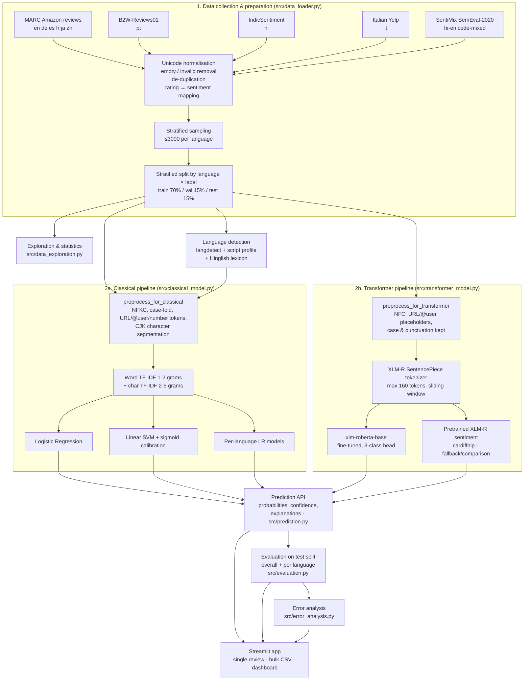

# Multilingual Review Sentiment Analysis System

**MCA AI & ML - Semester III Capstone Project**
**Subject:** ETMMTI303 - Language Technologies and Text Intelligence

An end-to-end NLP system that classifies customer reviews written in many languages - including
Hindi-English code-mixed text (Hinglish) - as **positive**, **negative** or **neutral**. It covers the whole
pipeline: dataset collection, cleaning, exploration, language-aware preprocessing, language detection, a
classical TF-IDF baseline, a fine-tuned multilingual transformer (XLM-RoBERTa), evaluation, error analysis,
explainability and a Streamlit application.

---

## Contents

1. [Problem statement](#1-problem-statement)
2. [Objectives](#2-objectives)
3. [System architecture](#3-system-architecture)
4. [Technology stack](#4-technology-stack)
5. [Dataset](#5-dataset)
6. [Preprocessing](#6-preprocessing)
7. [Language detection](#7-language-detection)
8. [Classical model: TF-IDF + LR / SVM](#8-classical-model-tf-idf--logistic-regression--svm)
9. [Transformer model: XLM-RoBERTa](#9-transformer-model-xlm-roberta)
10. [Explainability](#10-explainability)
11. [Evaluation methodology](#11-evaluation-methodology)
12. [Results](#12-results)
13. [Error analysis](#13-error-analysis)
14. [Limitations](#14-limitations)
15. [Installation (.venv)](#15-installation-venv)
16. [Running the project](#16-running-the-project)
17. [Project structure](#17-project-structure)
18. [Testing](#18-testing)
19. [References](#19-references)

---

## 1. Problem statement

E-commerce platforms receive reviews in many languages, and Indian users often mix Hindi and English in the
same sentence ("Product bahut accha hai, quality is amazing!"). A sentiment system built for English only
either fails on these reviews or forces them through machine translation, which loses nuance and adds cost.
The goal is a single system that classifies reviews in their **original language**, reports **how confident**
it is, **explains** its decision, and is **honestly evaluated per language**.

## 2. Objectives

1. Collect genuine, publicly available multilingual review data with sentiment labels; document sources,
   label mappings and limitations.
2. Implement language-aware preprocessing (separate pipelines for classical ML and transformers).
3. Detect the language of each review, including Hindi-English code-mixing where technically possible.
4. Train a classical TF-IDF baseline (Logistic Regression and linear SVM; shared and per-language models).
5. Fine-tune `xlm-roberta-base` for 3-class sentiment classification.
6. Evaluate all models on the same held-out test set, overall and per language; analyse errors.
7. Deliver a Streamlit application for single reviews, bulk CSV analysis, analytics, evaluation and error analysis.

## 3. System architecture



## 4. Technology stack

| Purpose | Library (version tested) |
|---|---|
| Language | Python 3.11 (3.10 also compatible) in a project-local `.venv` |
| Data processing | pandas 3.1, NumPy 2.2, PyArrow |
| Classical ML | scikit-learn 1.9 (TF-IDF, Logistic Regression, LinearSVC, calibration), joblib |
| Transformers | PyTorch 2.15, Hugging Face Transformers 5.22, SentencePiece |
| Language detection | langdetect 1.0.9 + custom script/lexicon heuristics |
| NLP resources | NLTK stop-word lists (exploration and lexicon disambiguation only) |
| Visualisation | Plotly (interactive), Matplotlib (static report figures) |
| UI | Streamlit 1.66 |
| Testing | pytest |

No paid APIs are used. All models and datasets are downloaded once into the project directory.

## 5. Dataset

### 5.1 Sources

| Language | Code | Source | Domain | Original label | Licence |
|---|---|---|---|---|---|
| English, German, Spanish, French, Japanese, Chinese | en, de, es, fr, ja, zh | **MARC** - Multilingual Amazon Reviews Corpus (Keung et al., 2020), HF mirror [`mteb/amazon_reviews_multi`](https://huggingface.co/datasets/mteb/amazon_reviews_multi) - official validation + test files (10,000 reviews per language) | Amazon products | 1-5 stars | MARC licence (non-commercial research) |
| Portuguese (Brazil) | pt | **B2W-Reviews01** (Real et al., 2019), [GitHub](https://github.com/americanas-tech/b2w-reviews01) - 132,373 reviews | Brazilian e-commerce | 1-5 stars | CC BY-NC-SA 4.0 |
| Hindi | hi | **IndicSentiment** (AI4Bharat, IndicXTREME 2023), [`ai4bharat/IndicSentiment`](https://huggingface.co/datasets/ai4bharat/IndicSentiment) | Products & services | Positive / Negative | CC0 |
| Italian | it | **Italian Yelp reviews**, [`yeniguno/italian-yelp-reviews-dataset`](https://huggingface.co/datasets/yeniguno/italian-yelp-reviews-dataset) | Restaurants | 0 / 1 / 2 | Yelp dataset terms (derived) |
| Hinglish (code-mixed) | hi-en | **SentiMix** - SemEval-2020 Task 9 (Patwa et al., 2020), mirror [`RTT1/SentiMix`](https://huggingface.co/datasets/RTT1/SentiMix) | Twitter (politics, entertainment) | positive / negative / neutral + token-level `Hin`/`Eng` tags | Research use |

Every record keeps `review_id`, `language`, `source`, `source_split`, the **original label**
(`original_label`, e.g. "4 stars") and the derived `sentiment`.

### 5.2 Label mapping

* **Star ratings (MARC, B2W):** 1-2 stars → negative, 3 stars → neutral, 4-5 stars → positive.
* **IndicSentiment:** native `Positive` / `Negative` labels. Although the dataset card mentions a neutral
  class, the Hindi files contain **no neutral reviews** (581 positive, 573 negative in the raw files).
* **Italian Yelp:** native 0 = negative, 1 = neutral, 2 = positive (verified by reading examples).
* **SentiMix:** native positive / negative / neutral.

### 5.3 Cleaning and sampling (measured, from `data/processed/dataset_summary.json`)

1. Unicode NFC normalisation, HTML tag/entity removal, whitespace collapsing.
2. Removal of missing/empty texts (B2W: 134) and of texts with no letter or digit.
3. Removal of invalid labels (Hindi: 2 rows with an unexpected label).
4. Duplicate removal after case/whitespace normalisation (B2W: 2,569; SentiMix: 75; zh: 7; fr: 3; es: 2; hi: 2).
   If the *same text* appeared with *different labels*, **all** copies were removed as label noise
   (B2W: 460; SentiMix: 93; zh: 2).
5. Stratified sampling of at most **3,000 reviews per language** (label proportions preserved) to keep
   training feasible on a laptop CPU/4 GB GPU. Hindi has only 1,152 clean reviews and is used in full.
6. Stratified **70 / 15 / 15** train / validation / test split by *language × sentiment* (seed 42).
   A test verifies that no review id or identical text is shared between splits.

### 5.4 Final dataset

**28,152 reviews, 10 language groups, 5 sources.** Train 19,706 · validation 4,223 · test 4,223.

| Language | Source | Negative | Neutral | Positive | Total | Median length (chars) |
|---|---|---:|---:|---:|---:|---:|
| English | MARC | 1,200 | 600 | 1,200 | 3,000 | 158 |
| German | MARC | 1,200 | 600 | 1,200 | 3,000 | 179 |
| Spanish | MARC | 1,200 | 600 | 1,200 | 3,000 | 141 |
| French | MARC | 1,200 | 600 | 1,200 | 3,000 | 143 |
| Japanese | MARC | 1,200 | 600 | 1,200 | 3,000 | 82 |
| Chinese | MARC | 1,200 | 600 | 1,200 | 3,000 | 45 |
| Portuguese | B2W | 790 | 373 | 1,837 | 3,000 | 112 |
| Italian | Yelp-IT | 605 | 326 | 2,069 | 3,000 | 422 |
| Hinglish | SentiMix | 881 | 1,130 | 989 | 3,000 | 119 |
| Hindi | IndicSentiment | 572 | 0 | 580 | 1,152 | 125 |
| **All** | | **10,048** | **5,429** | **12,675** | **28,152** | 133 |

Class imbalance: neutral is the minority class overall (19%); Italian and Portuguese are positive-heavy;
Hindi has no neutral class. Both model families use class-balanced loss/weights.

Run `python -m src.data_exploration` for the full statistics (missing values, duplicates, length
distribution, sentiment by language, frequent terms) and figures in `reports/figures/`.

### 5.5 Demonstration samples vs. dataset records

The *Single Review* page offers a few short **demonstration sentences written for the user interface**;
they are labelled as such and are never used for training or evaluation. The page can also load a
**random real review from the test split** and shows its dataset label. `assets/sample_reviews.csv`
(used by the bulk-analysis page) contains 250 **real test-split reviews** (25 per language) with labels.

## 6. Preprocessing

Implemented in `src/preprocessing.py`. The original review text is always kept for display.

| Step | Classical pipeline (`preprocess_for_classical`) | Transformer pipeline (`preprocess_for_transformer`) |
|---|---|---|
| Unicode | NFKC (also folds full-width ＡＢＣ/！ common in Japanese/Chinese reviews) | NFC |
| HTML | tags removed | tags removed |
| URLs / e-mails / @mentions | → `httpurl` / `emailaddr` / `@user` | → `http` / `email` / `@user` |
| Case | case-folded (`casefold`, handles ß etc.) | **kept** |
| Numbers | → `0` | kept |
| Elongation | "sooooo" → "soo" | kept |
| Punctuation & emoji | kept for character n-grams; ignored by the word tokenizer | **kept** |
| Chinese / Japanese | characters separated by spaces (character-level tokens) | kept as is |
| Tokenisation | Unicode-aware regex (see below) | XLM-R SentencePiece tokenizer |
| Stop words | **not removed** | not removed |
| Translation | **none** | none |

**Why stop words are not removed:** generic stop-word lists contain negations - *not, nicht, pas, no, non,
não, nahi* - which reverse sentiment. NLTK stop-word lists are used only for the "frequent terms" view in
the analytics page and for disambiguating the Hinglish lexicon.

**Indic tokenisation pitfall:** Python's `\w` does not match Indic vowel signs (Unicode category Mc/Mn), so
scikit-learn's default token pattern splits "अच्छा" into fragments. The project's `WORD_PATTERN` explicitly
includes combining-mark ranges for Devanagari and other Indic scripts (unit-tested).

## 7. Language detection

Implemented in `src/language_detection.py`, combining three signals:

1. **langdetect** (naive Bayes over character n-grams, 55 languages; seeded for deterministic output) -
   top candidates with probabilities.
2. **Script profile** - share of Latin / Devanagari / Han / Kana / … letters. Devanagari and Latin both
   ≥ 15% → code-mixed Hindi-English.
3. **Hinglish lexicon** - romanised Hindi is written in Latin script, so langdetect returns an arbitrary
   language (often Indonesian or Somali). A lexicon of 1,155 romanised-Hindi and 410 English words was
   **learned from the token-level `Hin`/`Eng` annotations of SentiMix** (only tweets *not* used in the
   project dataset). Words that are also European function words (e.g. *se*, *non*, *hai* in Italian) count
   only 0.25, and langdetect is trusted for confident European predictions unless at least two
   unambiguous Hindi words are present.
   *Measured on the held-out SentiMix dev file:* token-level accuracy **95.7%** on the 39.5% of tokens
   covered by the lexicon.

The detector reports: language, confidence, method, top candidates, script profile, token-level tags,
whether the text is **too short** (< 3 words or < 10 letters), **low confidence** (< 70%), **unsupported**
(not in the training data - the transformer can still be used), or **failed** (no letters). The user can
always override the language manually. Code-mixed detection is a heuristic for Hindi-English only;
standard language identifiers assign one language per text.

## 8. Classical model: TF-IDF + Logistic Regression / SVM

Implemented in `src/classical_model.py`.

* **Representation:** concatenation (`FeatureUnion`) of
  * word TF-IDF - unigrams + bigrams, Unicode-aware tokenizer, `min_df=2`, `max_df=0.9`, sublinear TF;
  * character TF-IDF - 2-5-grams within word boundaries (`char_wb`), `min_df=3`, sublinear TF.

  Character n-grams work for every script, share sub-word units between related languages
  ("excel-" in *excellent / excelente / eccellente*) and tolerate Hinglish spelling variation
  (*nahi / nhi / nahin*). Chinese/Japanese are segmented into characters before vectorisation.
* **Models:**
  1. shared multilingual **Logistic Regression** (`class_weight="balanced"`, lbfgs);
  2. shared multilingual **Linear SVM** wrapped in `CalibratedClassifierCV` (sigmoid, 3-fold) to obtain
     probabilities. Balanced *sample weights* are passed to both the SVM and the calibrators - with
     `class_weight` on the SVM only, calibration re-learned the raw class frequencies and neutral was
     rarely predicted (validation macro-F1 dropped from 0.63 to 0.59 in a 6,000-review check);
  3. **per-language Logistic Regression** - one model per language (fallback: shared model).
* **Model selection:** `C` chosen on the validation split by macro-F1 (grid LR: 0.1-2, SVM: 0.02-1);
  the test split is not used.
* **Saved artefacts:** `models/classical/*.joblib` (each a scikit-learn `Pipeline` containing the fitted
  vectoriser and classifier) and `training_summary.json` (grid scores, vocabulary sizes, training time).

## 9. Transformer model: XLM-RoBERTa

Implemented in `src/transformer_model.py` (plain PyTorch training loop so every step is visible).

* **Base model:** `xlm-roberta-base` (278M parameters, pre-trained on 2.5 TB of CC-100 text in 100
  languages, SentencePiece vocabulary of 250k tokens) with a new 3-class classification head.
* **Fine-tuned on the project's training split** (19,706 reviews, all languages mixed).
* **Configuration** (`config/settings.py`): max length 160 tokens (5.0% of training reviews are longer
  and are truncated during training), batch size 16, AdamW with learning rate 3e-5 and weight decay 0.01,
  linear warm-up (10%) and decay, up to 4 epochs, gradient clipping at 1.0, fp16 mixed precision on GPU,
  class-weighted cross-entropy, seed 42.
* **Early stopping & checkpoints:** validation macro-F1 is computed after every epoch; the best checkpoint
  is saved to `models/transformer/xlmr-finetuned/` (model + tokenizer + `training_history.json` with
  training loss, validation loss, learning rate and metrics per epoch). Training stops when validation
  macro-F1 does not improve for 1 epoch.
* **4 GB GPU trade-off:** 192M of the 278M parameters are the embedding matrix. Training all parameters
  with AdamW needs ≈ 4.5 GB for weights, gradients and optimiser states alone, so the **embedding matrix
  is frozen** and the 85.6M encoder + classifier parameters are trained (`--no-freeze-embeddings` disables
  this on larger GPUs). Peak GPU memory: ≈ 3.1 GB.
* **Long reviews at inference:** reviews longer than 160 tokens are split into overlapping windows
  (stride 32); the class probabilities of all windows are averaged.
* **CPU support:** inference runs on CPU automatically when no GPU is available; training on CPU works
  but is slow (`--cpu --max-train-samples 3000 --epochs 2` is a practical setting).
* **Pretrained fallback / extra baseline:** `cardiffnlp/twitter-xlm-roberta-base-sentiment` is an
  XLM-R model fine-tuned *by its authors* on tweets in 8 languages (ar, en, fr, de, hi, it, es, pt). It was
  **not trained on this project's data**. It is used automatically (with a visible notice) if the
  fine-tuned model is missing, and it is evaluated as an additional comparison point. No English-only
  model is ever substituted.

## 10. Explainability

* **Classical models - exact feature contributions.** For a linear model, the score for a class is
  Σ (TF-IDF value × class weight) + bias, so each product is exactly the feature's contribution. The app
  shows the top supporting and opposing word/character n-grams (a unit test checks that the contributions
  plus bias equal the model's decision score).
* **Transformers - occlusion (leave-one-word-out).** Each word (each character for Chinese/Japanese) is
  removed in turn and the drop in the predicted class probability is measured; words are highlighted
  green (supported the prediction) or red (opposed it). This measures real changes in the model output.
  Attention weights are deliberately *not* presented as explanations, because attention alone does not
  show why a model made a prediction.

## 11. Evaluation methodology

* All models are evaluated on **the same 4,223 held-out test reviews** (15% of each language, stratified
  by label) that were never used for training, `C` selection or early stopping.
* Metrics (`src/evaluation.py`): accuracy, macro and weighted precision / recall / F1, per-class
  classification report, confusion matrix, **per-language** metrics, measured training time and
  inference time per review.
* Per-language macro-F1 averages over the classes present in that language (Hindi has no neutral class);
  a neutral prediction for a Hindi review still counts as an error.
* Language detection accuracy is measured on the test set against each review's dataset language.
* Outputs: `data/evaluation/test_predictions.csv`, `reports/evaluation_results/` (metrics JSON, CSV
  tables, classification reports, confusion-matrix and comparison PNGs).

## 12. Results

All numbers below were produced by `python -m src.evaluation` on the **4,223-review test split** and are
stored in `reports/evaluation_results/`. Hardware: 12-core laptop CPU, NVIDIA RTX 3050 Laptop GPU (4 GB).

### 12.1 Overall test-set results

| Model | Trained on project data | Accuracy | Precision (macro) | Recall (macro) | **Macro-F1** | Weighted-F1 | Training time | Inference |
|---|---|---:|---:|---:|---:|---:|---:|---:|
| TF-IDF + Logistic Regression (shared) | yes | 0.7102 | 0.6653 | 0.6683 | 0.6658 | 0.7152 | 32 s (CPU) | 1.3 ms/review |
| TF-IDF + Linear SVM (shared, calibrated) | yes | 0.6709 | 0.6120 | 0.6147 | 0.6106 | 0.6672 | 16 s (CPU) | 1.3 ms/review |
| TF-IDF + Logistic Regression (per language) | yes | 0.7175 | 0.6650 | 0.6655 | 0.6650 | 0.7171 | 62 s (CPU) | 1.7 ms/review |
| **XLM-RoBERTa base, fine-tuned** | yes | **0.7722** | **0.7271** | **0.7303** | **0.7278** | **0.7767** | 34 min (GPU)* | 13.8 ms/review (GPU) |
| XLM-R sentiment, pretrained (cardiffnlp) | **no** | 0.7023 | 0.6037 | 0.6081 | 0.5903 | 0.6747 | - | 11.6 ms/review (GPU) |

\* 2,051 s measured. Epoch 1 took 933 s because the GPU was shared with another process at the time; the
other epochs took 334-370 s each, so an uncontended run is roughly 23 minutes.

**Per-class F1 (test):**

| Model | negative | neutral | positive |
|---|---:|---:|---:|
| TF-IDF + LR | 0.737 | 0.448 | 0.813 |
| TF-IDF + SVM | 0.740 | 0.344 | 0.748 |
| TF-IDF + LR per language | 0.747 | 0.433 | 0.815 |
| XLM-R fine-tuned | 0.801 | 0.511 | 0.871 |
| XLM-R pretrained | 0.742 | 0.207 | 0.822 |

Neutral is the hardest class for every model. The pretrained XLM-R model (trained on tweets, never on
these reviews) almost never predicts neutral for 3-star product reviews (neutral recall 0.15), which shows
why fine-tuning on in-domain data matters.

### 12.2 Language-wise macro-F1 (test)

| Language | n (test) | TF-IDF + LR | TF-IDF + LR per-lang | TF-IDF + SVM | **XLM-R fine-tuned** | XLM-R pretrained |
|---|---:|---:|---:|---:|---:|---:|
| English | 450 | 0.655 | 0.650 | 0.585 | **0.752** | 0.577 |
| German | 450 | 0.667 | 0.682 | 0.619 | **0.737** | 0.558 |
| Spanish | 450 | 0.678 | 0.674 | 0.531 | **0.735** | 0.642 |
| French | 450 | 0.683 | 0.695 | 0.588 | **0.763** | 0.555 |
| Italian | 450 | 0.649 | 0.676 | 0.534 | **0.733** | 0.523 |
| Portuguese | 450 | 0.689 | 0.726 | 0.597 | **0.777** | 0.649 |
| Hindi | 173 | 0.925 | 0.919 | **0.936** | 0.925 | 0.823 |
| Japanese | 450 | 0.580 | 0.592 | 0.458 | **0.693** | 0.633 |
| Chinese | 450 | 0.594 | 0.613 | 0.474 | **0.662** | 0.533 |
| Hinglish (code-mixed) | 450 | 0.545 | 0.571 | 0.581 | **0.595** | 0.532 |

Observations (measured, not assumed):

* Fine-tuned XLM-R has the highest macro-F1 in **9 of 10** language groups; the largest gain over the shared
  TF-IDF + LR is for **Japanese (+0.112)**, followed by English (+0.097) and Portuguese (+0.088).
* On **Hindi** the classical models are as good as XLM-R (LR 0.925 = XLM-R 0.925; the SVM is best with
  0.936). Hindi is a binary task here (no neutral class) with short, clearly polarised, translated reviews.
* **Hinglish** is the hardest group for every model (best 0.595): tweets, romanised spelling variation and
  many off-topic/ambiguous neutral posts.
* **Chinese and Japanese** are the hardest review languages for TF-IDF (character n-grams lack word
  segmentation); XLM-R's sub-word vocabulary helps most here.
* **Per-language TF-IDF** models are slightly better than the shared model for most languages
  (e.g. Portuguese 0.726 vs 0.689) but equal overall (0.665 vs 0.666): a shared vocabulary gives little
  cross-lingual transfer, while separate models have less data each.
* The calibrated **SVM** is the weakest classical model on macro-F1 because sigmoid calibration lowers
  its neutral recall (0.33) - even with balanced sample weights (see section 8).

### 12.3 XLM-R fine-tuning curve

| Epoch | Training loss | Validation loss | Validation accuracy | Validation macro-F1 | LR at end of epoch |
|---:|---:|---:|---:|---:|---:|
| 1 | 0.801 | 0.740 | 0.757 | 0.684 | 2.5e-5 |
| 2 | 0.625 | 0.654 | 0.740 | 0.707 | 1.7e-5 |
| **3** | 0.494 | 0.708 | 0.759 | **0.719** (best, saved) | 8.3e-6 |
| 4 | 0.380 | 0.835 | 0.758 | 0.715 → early stop | 0 |

Validation loss is lowest after epoch 2 but macro-F1 keeps improving until epoch 3: the model becomes more
confident (higher loss on its mistakes) while ranking classes better. The checkpoint is selected on
validation macro-F1, the project's main metric.

### 12.4 Classical model selection (validation split)

| Model | C grid → validation macro-F1 | Selected C | Vocabulary |
|---|---|---:|---|
| TF-IDF + LR | 0.1 → 0.640 · 0.25 → 0.652 · **0.5 → 0.660** · 1 → 0.654 · 2 → 0.651 | 0.5 | 112,811 word + 118,964 character n-grams |
| TF-IDF + SVM | 0.02 → 0.560 · 0.05 → 0.600 · **0.1 → 0.605** · 0.3 → 0.594 · 1 → 0.581 | 0.1 | same vocabulary |

### 12.5 Language detection (test split)

| Language | Accuracy | Most common confusion |
|---|---:|---|
| German, Hindi, Italian, Japanese | 100.0% | - |
| English | 99.3% | 3 reviews (ro, de, hi-en) |
| French | 99.3% | en (3) |
| Spanish | 98.0% | pt (5), it (2) |
| Portuguese | 98.0% | it (4), ca (2) |
| Chinese | 96.2% | **ko (17)** - langdetect confuses some short Chinese reviews with Korean |
| Hinglish | 71.8% | en (112) - many SentiMix tweets are almost entirely English |
| **All** | **96.0%** | |

The Hinglish thresholds were tuned on the validation split. An earlier version that also used NLTK's
`hinglish` stop-word list flagged 18 English test reviews as Hinglish because that list contains English
words such as *good*, *like*, *five*; it was removed (now 1 false positive).

## 13. Error analysis

`src/error_analysis.py` and the *Error Analysis* page work on the real test predictions:

* incorrect **positive**, **negative** and **neutral** predictions (most confident mistakes first);
* misclassified reviews and confusion types **per language**;
* reviews where the **classical model and the transformer disagree**, and which one was right;
* **linguistic cues** attached to every review - negation words, contrast words (*but / aber / lekin / 但*),
  code-mixing, very short (< 6 words) or long (> 600 characters) text, 3-star-derived neutral labels -
  with the **error rate with vs. without each cue**, so possible causes are checked quantitatively;
* a discussion of causes that cannot be detected automatically: sarcasm, slang and spelling, ambiguous
  opinions, domain-specific words, insufficient data for some languages, and label noise from rating mapping.

**Measured on the test split (fine-tuned XLM-R):** 962 errors (22.8%). Most errors involve the neutral class:

| True → predicted | Count | Share of errors |
|---|---:|---:|
| negative → neutral | 266 | 27.7% |
| positive → neutral | 219 | 22.8% |
| neutral → negative | 213 | 22.1% |
| neutral → positive | 156 | 16.2% |
| negative → positive | 56 | 5.8% |
| positive → negative | 52 | 5.4% |

**Error rate with vs. without a cue** (heuristic cues; positive difference = cue makes errors more likely):

| Cue | Reviews | XLM-R with / without | TF-IDF + LR with / without |
|---|---:|---:|---:|
| 3-star (mapped neutral) label | 596 | **46.3% / 18.9%** | **58.1% / 24.2%** |
| code-mixed Hinglish | 450 | 40.9% / 20.6% | 44.7% / 27.1% |
| contrast word (but / aber / pero / lekin …) | 1,303 | 29.7% / 19.7% | 39.1% / 24.5% |
| negation word | 2,291 | 24.7% / 20.5% | 32.0% / 25.4% |
| long (> 600 characters) | 209 | 21.5% / 22.8% | 29.2% / 29.0% |

Contrast and negation hurt the bag-of-words model more than the transformer (+14.7 vs +10.0 and +6.6 vs
+4.1 percentage points), consistent with XLM-R modelling context. Both models struggle most with 3-star
reviews, which points to label ambiguity rather than a modelling failure.

**Disagreements:** TF-IDF + LR and XLM-R disagree on 1,019 test reviews (24.1%); XLM-R is right on 569,
LR on 307, neither on 143. Disagreement is highest for Hinglish (37.8%) and lowest for Portuguese (11.8%).
655 reviews are misclassified by both models.

**Real test-set examples** (all misclassified by the fine-tuned XLM-R):

| Lang | Review (excerpt) | Gold | XLM-R | Likely cause |
|---|---|---|---|---|
| ja | お勧めできない … これはひどいですね … (*"Cannot recommend … this is terrible"*) | neutral (3★) | negative (0.99) | label noise from 3-star mapping - the text is clearly negative |
| es | Buena calidad pero muy caros (*"Good quality but very expensive"*) | negative (2★) | neutral (0.90) | mixed opinion with *pero* (but) |
| en | Nice looking but stiff. Great looking but the fabric is stiff … | positive (4★) | neutral (0.91) | contrast; rating more positive than text |
| it | Buone margarita abbinate al cibo messicano più bianco da questa parte di Taco Bell | negative | positive (0.79) | sarcasm (translated Yelp review) |
| hi | स्थानीय या बस सेवा की तुलना में रेट्स अधिक हैं (*"Rates are higher than local bus service"*) | negative | positive (0.96) | implicit, comparative negativity without negative words |
| hi-en | i love feeding my cat straight cans of tuna. bich loves ~ me for it | negative | positive (0.96) | slang/irony; questionable gold label |
| de | Gute Qualität Sehr Robust … Leider mag sie mein Hund nicht | neutral (3★) | positive (0.91) | positive product, negative outcome; 3-star ambiguity |

## 14. Limitations

* **Labels are proxies.** Star ratings are mapped to sentiment; 3-star reviews often mix praise and
  complaints, so the neutral class is intrinsically ambiguous.
* **Domains differ by language** (Amazon products, Brazilian e-commerce, restaurants, political tweets), so
  per-language scores mix language difficulty with domain difficulty.
* **Translated data:** the Italian reviews are machine-translated from English Yelp; IndicSentiment Hindi
  reviews were translated from English by annotators. Native Italian/Hindi reviews may behave differently.
* **Hinglish data are tweets**, not product reviews - the only genuine, labelled Hindi-English code-mixed
  corpus that could be obtained. Romanised Hindi spelling is highly inconsistent.
* **Hindi is small** (1,152 reviews) and has no neutral class; the model cannot be evaluated on neutral Hindi.
* **Subset of the corpora:** at most 3,000 reviews per language were used for hardware reasons; larger
  samples would likely improve all models.
* **Embedding matrix frozen** during fine-tuning (4 GB GPU); full fine-tuning may perform better.
* **Single split / single seed** - no confidence intervals; differences of ~1 percentage point between
  models should not be over-interpreted, especially for small languages.
* **Code-mixed language detection** is a lexicon heuristic for Hindi-English only.
* **Confidence ≠ correctness:** confidence is the highest predicted probability; the error-analysis page
  shows many high-confidence mistakes.

## 15. Installation (.venv)

All packages are installed **only** inside the project's virtual environment. Do not use the global `pip`.

### Windows (PowerShell)

```powershell
# from the project root
python -m venv .venv
.\.venv\Scripts\Activate.ps1
# verify that the venv interpreter is active (path must end in .venv\Scripts\python.exe)
python -c "import sys; print(sys.executable)"
python -m pip install --upgrade pip
python -m pip install -r requirements.txt
```

If PowerShell blocks the activation script, run once:
`Set-ExecutionPolicy -Scope CurrentUser -ExecutionPolicy RemoteSigned`.

### Linux / WSL / macOS

```bash
python3 -m venv .venv
source .venv/bin/activate
python -c "import sys; print(sys.executable)"   # must point into .venv
python -m pip install --upgrade pip
python -m pip install -r requirements.txt
```

*GPU (optional):* the default PyPI `torch` wheel on Windows is CPU-only. For an NVIDIA GPU install the
CUDA build from <https://pytorch.org/get-started/locally/> **inside the activated `.venv`**.

*VS Code:* `.vscode/settings.json` points the Python extension to `.venv`; on Windows choose
`.venv\Scripts\python.exe` via **Python: Select Interpreter** if it is not picked automatically.

Downloads are stored inside the project: datasets in `data/raw/`, NLTK stop words in `data/nltk_data/`,
Hugging Face models in `models/hf_cache/` (`HF_HOME` is set in `config/settings.py`).

## 16. Running the project

Run every command from the project root with the `.venv` activated.

```bash
# Full pipeline: data -> EDA -> classical -> XLM-R fine-tuning -> evaluation -> error analysis
python run_pipeline.py

# ...or step by step
python -m src.data_loader                 # download (once) and build data/processed/
python -m src.data_exploration            # statistics + figures in reports/figures/
python -m src.classical_model             # TF-IDF + LR / SVM / per-language LR
python -m src.transformer_model --download-only   # cache XLM-R models in models/hf_cache/
python -m src.transformer_model           # fine-tune XLM-R (GPU recommended)
python -m src.evaluation                  # test-set evaluation -> reports/evaluation_results/
python -m src.error_analysis              # error summaries and example tables

# CPU-only machines: a smaller fine-tuning run
python -m src.transformer_model --cpu --max-train-samples 3000 --epochs 2

# Start the application
streamlit run app.py
```

The app opens at <http://localhost:8501>. Pages:

| Page | What it does |
|---|---|
| Home | Introduction, objectives, languages, dataset size, available models, navigation |
| 1. Single Review Analysis | Automatic/manual language, model choice, probabilities, confidence, model comparison, explanations |
| 2. Bulk Review Analysis | CSV upload (encoding/delimiter detection, malformed rows reported), column selection, language mode, progress bar, results table, language-wise statistics, optional accuracy against a label column, CSV download |
| 3. Multilingual Analytics | KPIs and interactive charts for the dataset or the latest bulk results |
| 4. Model Evaluation | Metrics tables, confusion matrices, classification reports, per-language charts, training curves, language-ID accuracy |
| 5. Error Analysis | Misclassified examples by type and language, model disagreements, cue statistics, causes and limitations |
| 6. Model Comparison | TF-IDF vs XLM-R side by side, per-language differences, training/inference time, conceptual comparison |

Light/dark theme: the app follows the operating-system theme; switch via **⋮ → Settings → Theme**.

## 17. Project structure

```
.
├── app.py                         # Streamlit home page
├── run_pipeline.py                # runs the complete pipeline
├── requirements.txt
├── config/settings.py             # paths, labels, languages, hyper-parameters
├── src/
│   ├── data_loader.py             # download, parse, clean, de-duplicate, sample, split
│   ├── data_exploration.py        # EDA statistics and report figures
│   ├── preprocessing.py           # classical vs transformer preprocessing, tokenizer
│   ├── language_detection.py      # langdetect + script profile + Hinglish lexicon
│   ├── classical_model.py         # TF-IDF + LR / SVM / per-language, explanations
│   ├── transformer_model.py       # XLM-R fine-tuning, chunked inference, occlusion
│   ├── prediction.py              # unified prediction API, model loading, fallback
│   ├── bulk_analysis.py           # robust CSV reading and batch analysis
│   ├── evaluation.py              # metrics, per-language evaluation, artefacts
│   ├── error_analysis.py          # error tables, disagreements, cue statistics
│   ├── visualization.py           # Plotly + Matplotlib charts
│   └── ui.py                      # shared Streamlit helpers
├── pages/                         # Streamlit pages 1-6
├── data/
│   ├── raw/                       # downloaded corpora (git-ignored)
│   ├── processed/                 # reviews_all/train/val/test.csv, dataset_summary.json, hinglish_lexicon.csv
│   └── evaluation/                # test_predictions.csv
├── models/
│   ├── classical/                 # *.joblib pipelines + training_summary.json
│   ├── transformer/xlmr-finetuned # fine-tuned model, tokenizer, training_history.json
│   └── hf_cache/                  # Hugging Face download cache
├── reports/
│   ├── figures/                   # EDA figures
│   └── evaluation_results/        # metrics, reports, confusion matrices, comparisons
├── assets/sample_reviews.csv      # 250 real test reviews for the bulk-analysis demo
├── tests/                         # pytest suite
├── .streamlit/config.toml
└── .vscode/settings.json
```

## 18. Testing

```bash
python -m pytest -q
```

Last run: **63 passed** (pytest 9.2, Python 3.11, with trained models and evaluation artefacts present).

| Test file | What is verified |
|---|---|
| `test_preprocessing.py` | Hindi words keep vowel signs, CJK segmentation, URL/mention/number normalisation, negations kept, full-width folding, transformer text keeps case/punctuation/emoji, empty/invalid text |
| `test_language_detection.py` | en/fr/de/es/it/hi/ja detection, romanised Hinglish and Devanagari+Latin code-mixing, Italian not misflagged, empty text failure message, short-text warning, unsupported language |
| `test_classical_model.py` | valid probabilities, **exactness of TF-IDF explanations** (contributions + bias = decision score), 2-class → 3-class mapping, saved model loading |
| `test_prediction.py` | empty input rejected, documented fallback to the pretrained XLM-R, manual language override, real model outputs sum to 1 and confidence = max probability |
| `test_bulk_analysis.py` | semicolon/latin-1/UTF-16 CSVs, malformed lines skipped and reported, empty files, column guessing, label normalisation, invalid rows kept and marked, unexpected columns preserved |
| `test_evaluation.py` | metrics against hand-computed values, per-language macro over present classes, **no train/val/test overlap (ids and identical texts)** |
| `test_data_loader.py` | SentiMix CoNLL parsing, tweet detokenisation, empty/duplicate/conflicting-label removal, stratified split |
| `test_app_smoke.py` | every Streamlit page renders without errors; a real single-review analysis and a bulk analysis of the sample CSV through the UI |

Bugs found and fixed during testing include: Python's `\w` splitting Hindi words; pandas silently using
extra CSV fields as an index (`index_col=False`); latin-1 files being mis-decoded as UTF-16; calibrated SVM
ignoring class balancing; NLTK's `hinglish` list containing English words; pandas 3 Arrow-backed arrays
breaking scikit-learn indexing.

## 19. References

* Conneau et al. (2020). *Unsupervised Cross-lingual Representation Learning at Scale* (XLM-RoBERTa). ACL.
* Keung et al. (2020). *The Multilingual Amazon Reviews Corpus*. EMNLP.
* Real, Oshiro & Mafra (2019). *B2W-Reviews01: an open product reviews corpus*. STIL.
* Doddapaneni et al. (2023). *Towards Leaving No Indic Language Behind* (IndicXTREME / IndicSentiment). ACL.
* Patwa et al. (2020). *SemEval-2020 Task 9: Overview of Sentiment Analysis of Code-Mixed Tweets*. SemEval.
* Barbieri, Espinosa-Anke & Camacho-Collados (2022). *XLM-T: Multilingual Language Models in Twitter for
  Sentiment Analysis and Beyond*. LREC.
* Shuyo (2010). *Language Detection Library for Java* (langdetect).
